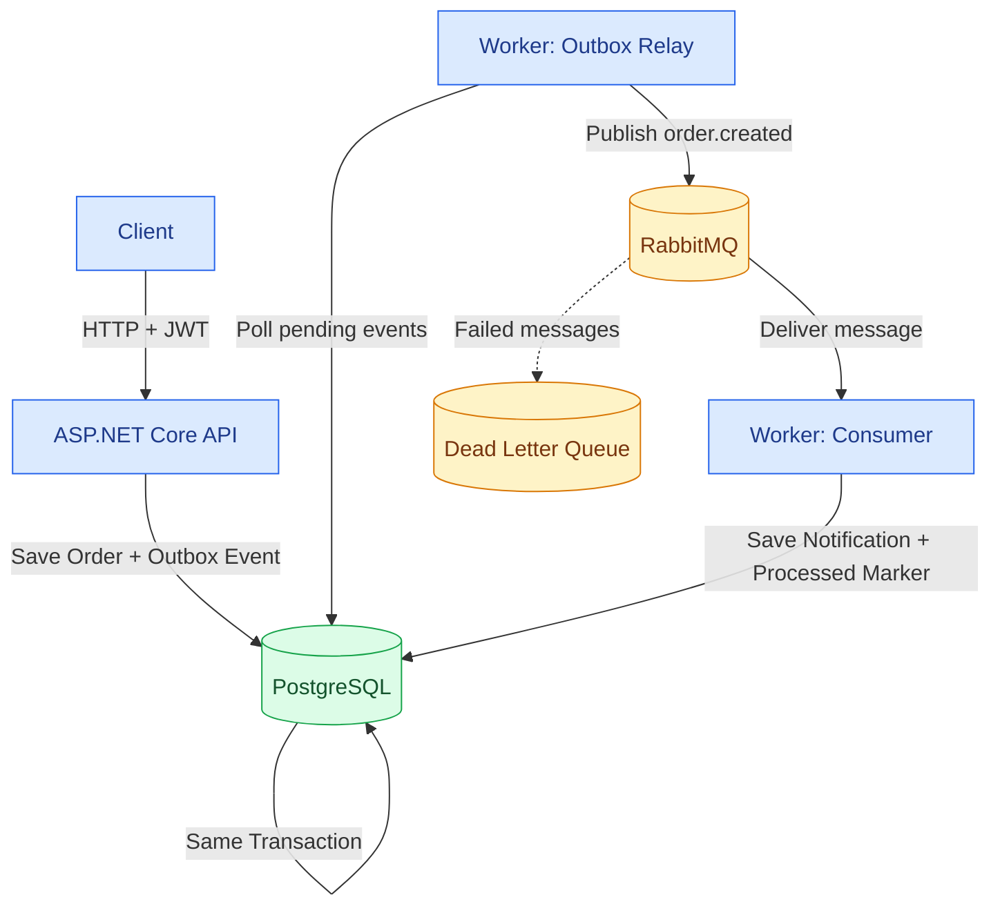
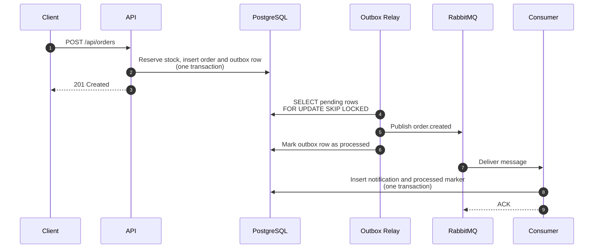

# Business Management API


ASP.NET Core (.NET 10) backend for products, customers and orders. It practises production-style
concerns: transactional stock reservation, JWT with roles, a transactional outbox with RabbitMQ,
and an idempotent consumer.

## Highlights
- Orders reserve stock with an atomic conditional UPDATE inside one transaction; 10 parallel requests for 5 units create exactly 5 orders (integration test).
- Transactional outbox + relay (`FOR UPDATE SKIP LOCKED`, exponential backoff); idempotent consumer, retry queue and dead-letter queue.
- Query-count tests prevent N+1; index choices verified with EXPLAIN ANALYZE (24 ms to under 1 ms on 100k orders).
- 200+ tests against real PostgreSQL and RabbitMQ (Testcontainers).

## Architecture
(two Mermaid diagrams, see below)

## Architecture - Transactional Outbox with RabbitMQ



## Transactional Outbox - Sequence Diagram



## Tech stack
.NET 10 (LTS), ASP.NET Core, EF Core 10, PostgreSQL 18, RabbitMQ 4, xUnit + Testcontainers, Docker Compose, GitHub Actions

## Quick start
```bash
cp .env.example .env 
docker compose up -d --build
```
API: http://localhost:8080 (`/health`) · RabbitMQ UI: http://localhost:15672

## Try it
(register, login, create product, customer, order, cancel with curl; one error example)

## Run the tests
Requires Docker (Testcontainers). `dotnet test`

## Design decisions
(one line each, link to docs/decisions.md or PROJECT_STATUS.md)

## Known limitations
(from the debt list: no payments yet, JWT cannot be revoked, no rate limiting, outbox cleanup job missing, ...)

## Project layout