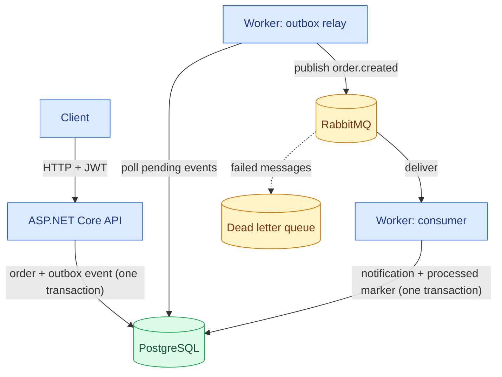

# Business Management API

[](https://github.com/TrinhTuanVinh/BusinessManagement/actions/workflows/ci.yml)

ASP.NET Core (.NET 10) backend for products, customers and orders. It practises production-style
concerns: transactional stock reservation, JWT with roles, a transactional outbox with RabbitMQ,
and an idempotent consumer.

## Highlights
- Orders reserve stock with an atomic conditional UPDATE inside one transaction; 10 parallel requests for 5 units create exactly 5 orders (integration test).
- Transactional outbox + relay (`FOR UPDATE SKIP LOCKED`, exponential backoff); idempotent consumer, retry queue and dead-letter queue.
- Query-count tests prevent N+1; index choices verified with EXPLAIN ANALYZE (24 ms to under 1 ms on 100k orders).
- 200+ tests against real PostgreSQL and RabbitMQ (Testcontainers).

## Architecture



### Order creation and event delivery


## Tech stack
.NET 10 (LTS), ASP.NET Core, EF Core 10, PostgreSQL 18, RabbitMQ 4, xUnit + Testcontainers, Docker Compose, GitHub Actions

## Quick start
Requires Docker.

```bash
cp .env.example .env          # PowerShell: Copy-Item .env.example .env
# edit .env: set POSTGRES_PASSWORD, RABBITMQ_PASSWORD (letters and digits only) and JWT_KEY (at least 32 characters)
docker compose up -d --build
```
- API: http://localhost:8080 (health check: `/health`)
- API docs (Swagger UI): http://localhost:8080/swagger
- RabbitMQ management UI: http://localhost:15672 (user and password from `.env`)

Compose refuses to start if a required value is missing. To reset all data: `docker compose down -v`.

## Try it
The commands below use bash and curl. Replace the placeholders in angle brackets with values from the previous responses.

```bash
BASE=http://localhost:8080

# 1. Register and log in (password: at least 10 characters)
curl -s -X POST $BASE/api/auth/register -H "Content-Type: application/json" \
  -d '{"email":"me@example.com","password":"CorrectHorse1!"}'
curl -s -X POST $BASE/api/auth/login -H "Content-Type: application/json" \
  -d '{"email":"me@example.com","password":"CorrectHorse1!"}'
# => {"accessToken":"<jwt>","tokenType":"Bearer","expiresAtUtc":"..."}
TOKEN=<paste the accessToken>

# 2. Create a product and a customer
curl -s -X POST $BASE/api/products -H "Authorization: Bearer $TOKEN" -H "Content-Type: application/json" \
  -d '{"name":"Widget","category":"Tools","price":100000,"stock":10}'
curl -s -X POST $BASE/api/customers -H "Authorization: Bearer $TOKEN" -H "Content-Type: application/json" \
  -d '{"fullName":"Alice","email":"alice@example.com"}'

# 3. Create an order (reserves stock; optional "voucherCode": "SALE10" for 10% off)
curl -s -X POST $BASE/api/orders -H "Authorization: Bearer $TOKEN" -H "Content-Type: application/json" \
  -d '{"customerId":"<customer id>","items":[{"productId":"<product id>","quantity":2}]}'

# 4. Cancel it (stock is restored exactly once)
curl -s -X POST $BASE/api/orders/<order id>/cancel -H "Authorization: Bearer $TOKEN"
```

Error example, ordering more than the stock (`409 Conflict`, RFC 7807 problem details):
```bash
curl -s -X POST $BASE/api/orders -H "Authorization: Bearer $TOKEN" -H "Content-Type: application/json" \
  -d '{"customerId":"<customer id>","items":[{"productId":"<product id>","quantity":1000}]}'
# => {"title":"Conflict","status":409,"detail":"Insufficient stock for product '...'.","traceId":"..."}
```

See the event flow: `docker compose logs worker` shows `Notification created for order ...` shortly after step 3,
and the queue `bm.orders.created` in the RabbitMQ UI stays empty because the consumer acknowledges each message.

### Roles
Registration always creates a `Staff` user. Admin-only endpoints (deleting a product, `GET /api/reports/top-customers`)
return `403` for Staff. There is no endpoint to promote a user on purpose; use SQL, then log in again to get a new token:
```bash
docker compose exec db psql -U app -d businessmanagement \
  -c "UPDATE \"Users\" SET \"Role\" = 'Admin' WHERE \"Email\" = 'me@example.com';"
```
(Use the PostgreSQL user from your `.env` if you changed it.)

## Run the tests
Requires Docker, because Testcontainers starts real PostgreSQL and RabbitMQ containers (the first run pulls the images).
```bash
dotnet test
```
Highlights: parallel stock reservation, parallel duplicate-message handling, query-count tests, the outbox through to the consumer, and a full HTTP flow on an empty database.

## Development without the API container
```bash
docker compose up -d db rabbitmq
dotnet user-secrets set "ConnectionStrings:Default" "<connection string for localhost:5434>" --project src/BusinessManagement.Api
dotnet user-secrets set "Jwt:Key" "<at least 32 characters>" --project src/BusinessManagement.Api
dotnet user-secrets set "Payments:Bank:MerchantAccount" "<any fake value>" --project src/BusinessManagement.Api
dotnet tool restore
dotnet ef database update --project src/BusinessManagement.Infrastructure --startup-project src/BusinessManagement.Api
dotnet run --project src/BusinessManagement.Api
dotnet run --project src/BusinessManagement.Worker      # needs the ConnectionStrings and RabbitMq secrets as well (same UserSecretsId)
```

## Design decisions
- **`DbContext` directly, no generic repository.** EF Core already provides the repository and unit-of-work behaviour; a wrapper would mostly hide `Include` and projections. The context sits behind `IAppDbContext` in the application layer.
- **Stock is reserved with one atomic conditional UPDATE** (`WHERE Stock >= qty`, check the affected rows) inside a transaction, with lines processed in a fixed product order to avoid deadlocks. A `CHECK Stock >= 0` constraint is the last line of defence.
- **Transactional outbox instead of publishing after commit.** Writing the database and the broker is not atomic; the event is stored with the order and a relay publishes it with backoff.
- **At-least-once delivery plus an idempotent consumer.** A `ProcessedMessages` row is written in the same transaction as the effect; a unique index settles races between consumers.
- **RabbitMQ rather than Kafka.** The work is a per-message queue that needs acknowledgements, retry and a dead-letter queue, with a single consumer. Kafka would fit better with several independent consumers or replay.
- **Layered architecture with dependencies pointing inward** (Domain, Application, Infrastructure, Api). One deliberate compromise: the application layer references EF Core.
- **Strategy and Factory for discount and voucher rules.** The payment adapter and decorator exist with tests but are not wired into the order flow yet.
- **JWT with role claims and a secure-by-default fallback policy;** login errors are identical for a wrong email and a wrong password.
- **Errors map consistently:** 400 for invalid shape, 404 for missing resources, 409 for conflicts, 422 for business-rule violations, and unexpected errors never leak details.
- **Fail-fast configuration:** missing or weak settings (connection string, JWT key, RabbitMQ) stop the app at startup.

More detail and the lessons learned are in `PROJECT_STATUS.md`.

## Known limitations
- No payments or order confirmation yet; pending orders hold stock indefinitely (a job to expire them is missing).
- No `Idempotency-Key` on `POST /api/orders`: retrying a request creates another order.
- Any signed-in user can view and cancel any order (orders are not tied to their creator).
- JWTs cannot be revoked before they expire; there is no rate limiting, password change or user management; `401` and `403` have empty bodies.
- `OutboxMessages` and `ProcessedMessages` grow without bound (a cleanup job is missing), and the relay holds a transaction while publishing a batch.
- Applying migrations at startup (enabled in Compose) is not safe with several API instances; production would run them as a separate job.
- `PUT` is last-write-wins; sorting by name depends on the PostgreSQL collation; `LIKE '%x%'` search cannot use an index.

## Project layout
```
src/
  BusinessManagement.Domain/           entities and their invariants, domain exceptions
  BusinessManagement.Application/      use cases (orders, products, customers, auth), pricing and discounts, ports
  BusinessManagement.Infrastructure/   EF Core and migrations, RabbitMQ, outbox relay, JWT and password hashing
  BusinessManagement.Api/              controllers, request DTOs, middleware, error handling
  BusinessManagement.Worker/           background services: outbox relay and RabbitMQ consumer
tests/
  BusinessManagement.UnitTests/        domain and application logic
  BusinessManagement.IntegrationTests/ real PostgreSQL and RabbitMQ (Testcontainers), HTTP end to end
scripts/                               seed-dev.sql: sample data for a development database
docker-compose.yml                     PostgreSQL, RabbitMQ, API and worker
.github/workflows/ci.yml               build and test on every push
```